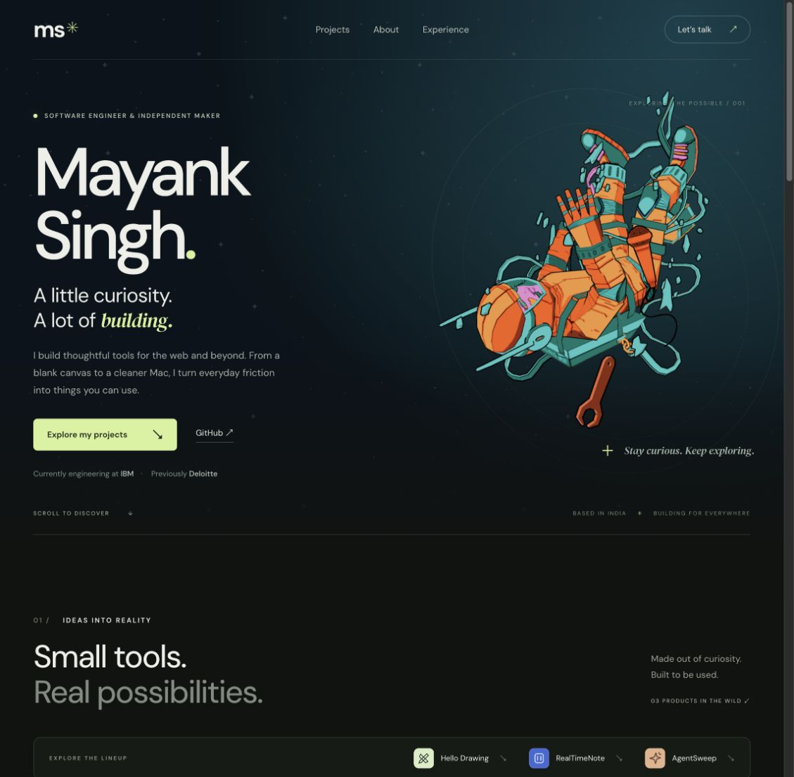
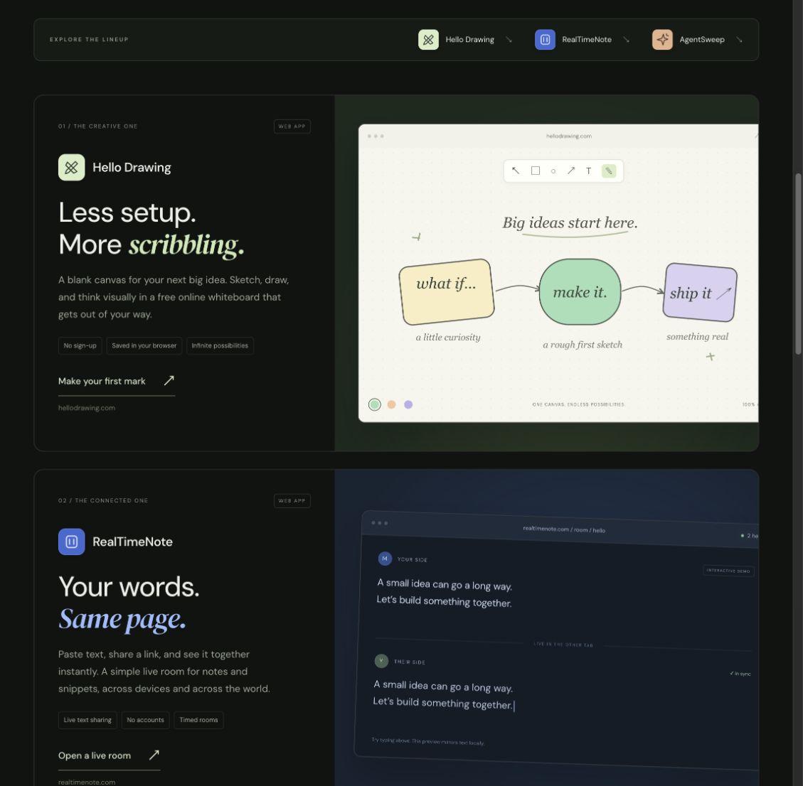

# Mayank Singh — Engineer & Maker

**A little curiosity. A lot of building.**

My personal portfolio, bringing together the products I’ve shipped and my experience as a software engineer. An animated astronaut opens the page, followed by hands-on product previews, a little about me, and ways to get in touch.

[GitHub](https://github.com/MS170998) · [LinkedIn](https://linkedin.com/in/mayanksingh17) · [Email](mailto:smayankanand3@gmail.com)



## Featured products

| Product | What it does | Try it |
| --- | --- | --- |
| **Hello Drawing** | A free online whiteboard for sketching, drawing, and thinking visually. No sign-up; drawings are saved in your browser. | [hellodrawing.com](https://hellodrawing.com/) |
| **RealTimeNote** | Share a live room link to read and edit text together across devices. No account or installation needed. | [realtimenote.com](https://realtimenote.com/) |
| **AgentSweep** | See the storage used by AI tools on your Mac and review what to keep or clean up. | [Visit AgentSweep](https://8080-agqu4klin73vwwocajlburtfcm.instabox.tech/) |



## Inside the portfolio

- **Animated introduction:** The existing astronaut model responds to pointer movement and scroll position, with a dedicated layout on phones.
- **Interactive product previews:** Change a sketch’s colors, type into a locally mirrored note, or preview an example storage scan. Each showcase links to the actual product.
- **About and experience:** A short introduction, everyday toolkit, and expandable experience at IBM, Deloitte, and Parul University.
- **Contact:** Email and social links, plus a copy-email button.
- **Accessibility:** A skip link, visible keyboard focus, labeled controls, and support for reduced-motion preferences. A footer control also turns motion on or off.
- **Rendering:** The 3D scene is lazy-loaded, its pixel ratio is capped, and continuous rendering pauses when the scene is out of view or motion is disabled.

The embedded product previews are demonstrations within the portfolio. The note preview mirrors text locally, and the AgentSweep preview uses labeled example data rather than scanning the visitor’s device.

## Built with

| Layer | Tools |
| --- | --- |
| Interface | React 18, JavaScript, CSS, Tailwind CSS |
| 3D scene | Three.js, React Three Fiber, React Three Drei |
| Development and build | Vite |
| Deployment | Vercel |

## Run locally

You’ll need Node.js, npm, and Git.

```bash
git clone https://github.com/MS170998/Portfolio-website.git
cd Portfolio-website
npm ci
npm run dev
```

Open the local URL printed by Vite. Press `Ctrl+C` in the terminal to stop the server.

The current portfolio runs entirely in the browser. No environment variables, backend service, or API keys are required.

## Build and preview

```bash
npm run build
npm run preview
```

The production build is written to `dist/`. The preview command serves that build locally; open the URL printed in the terminal and press `Ctrl+C` when finished.

| Command | Purpose |
| --- | --- |
| `npm run dev` | Start the development server with hot reload. |
| `npm run build` | Generate the production build in `dist/`. |
| `npm run preview` | Serve the production build for local review. |

## Project structure

```text
public/
  favicon.svg                 Portfolio monogram
  parallax/                   Space illustration assets
screenshots/
  redesign-home.png           Current introduction
  redesign-projects.png       Current product showcase
src/
  assets/3d/spaceman.glb       Astronaut model
  components/
    Navbar.jsx                Navigation and mobile menu
    Hero.jsx                  Introduction and space scene layout
    Spaceman.jsx              3D animation and rendering controls
    Projects.jsx              Product content and interactive previews
    Experience.jsx            About, toolkit, and experience sections
    Contact.jsx               Contact links and email copy
  data/index.js               Experience details
  App.jsx                     Page composition and motion preference
  index.css                   Styling and responsive layouts
  main.jsx                    React entry point
index.html                    Page metadata and favicon reference
```

### Update the content

- **Products:** Edit the `products` array in `src/components/Projects.jsx`. The preview components live in the same file.
- **Experience:** Update `src/data/index.js` and the summary copy in `src/components/Experience.jsx`.
- **Introduction and about:** Edit `src/components/Hero.jsx` and `src/components/Experience.jsx`.
- **Contact details:** Update `src/components/Contact.jsx`. The introduction and about section also contain social links.
- **Appearance:** Edit `src/index.css`. The favicon is `public/favicon.svg`; page titles and social metadata live in `index.html`.

## Deployment

The connected Vercel project automatically deploys pushes to `main`.

For a new Vercel setup, import this repository, select the **Vite** framework preset, use `npm run build` as the build command, and `dist` as the output directory. No environment variables are needed for the current implementation.

## Credits

- [Falling spaceman model](https://sketchfab.com/3d-models/tenhun-falling-spaceman-fanart-9fd80b6a259f41fd99e6f56eee686dc5) by **wallmasterr**.
- [Planet surface artwork](https://stock.adobe.com/images/landscape-surface-of-planet-sky-space-science-fiction-fantasy-illustration/330880441?asset_id=330880441) by **jongjawi**, credited in the original portfolio.
- [Teshank’s portfolio](https://github.com/teshank2137/portfolio), an animation reference for the earlier version.
