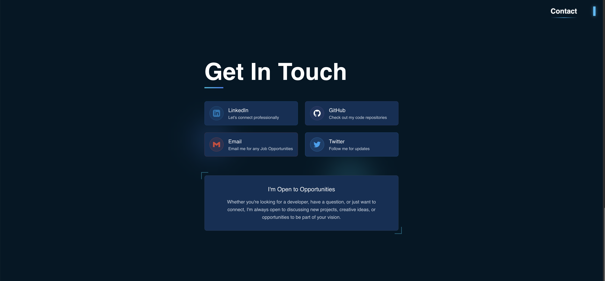
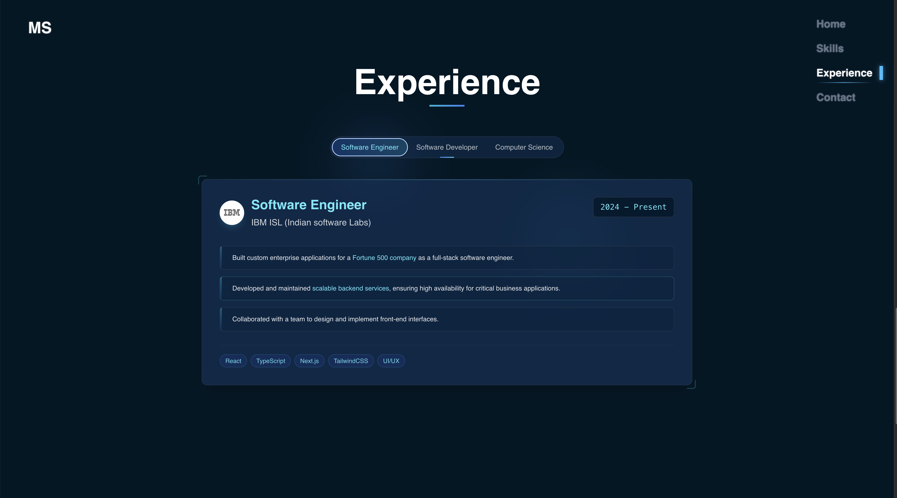
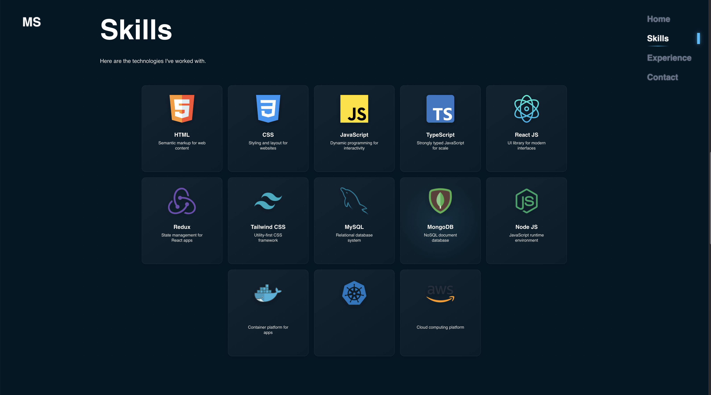

# Portfolio Website


## ✨ Overview

Mayank Singh’s personal portfolio: a space-inspired introduction followed by an interactive showcase of Hello Drawing, RealTimeNote, and AgentSweep.


## 🚀 Features

- **Immersive 3D Environment** - Interactive space-themed design with Three.js
- **Product Showcase** - Three live products with original interactive previews and direct links
- **Responsive Design** - Product cards stack on phones, with a dedicated mobile astronaut layout
- **Accessible Controls** - Keyboard navigation, reduced-motion support, expandable experience, and email copy
- **Efficient Animation** - Lazy-loaded 3D scene that stops rendering when out of view

## 🛠️ Technologies

<table>
  <tr>
    <td align="center"><br />Vite</td>
    <td align="center"><br />JavaScript</td>
    <td align="center"><br />React</td>
    <td align="center"><br />Tailwind</td>
  </tr>
  <tr>
    <td align="center"><br />Three.js</td>
    <td align="center"><br />Framer Motion</td>
    <td align="center"><br />GitHub</td>
  </tr>
</table>

## 🏗️ Installation & Setup

```bash 
# Clone the repository
git clone https://github.com/MS170998/Portfolio-website.git

# Navigate to the project
cd Portfolio-website

# Install dependencies
npm install

# Run development server
npm run dev
```

## 📷 Screenshots

<div align="center">
  
  
  <div style="display: flex; justify-content: space-between; margin-bottom: 20px">
    
    
  </div>
  
  
</div>

## 💡 Implementation Details

`src/components/Projects.jsx` holds the product content and previews. The whiteboard is an original interactive illustration, the text demo mirrors input locally, and the storage preview uses clearly marked example data. Product links open the real applications.

The astronaut keeps the existing 3D asset and animation, adds pointer and scroll movement, and respects the visitor’s reduced-motion preference. The footer also lets visitors turn motion off.

Build with `npm run build`, then serve the generated `dist` directory with any static host. Run `npm run preview` to inspect the production build locally.

## 🙏 Credits & Resources

- [Spaceman 3D Model](https://sketchfab.com/3d-models/tenhun-falling-spaceman-fanart-9fd80b6a259f41fd99e6f56eee686dc5) by wallmasterr
- [Planet Surface Texture](https://stock.adobe.com/images/landscape-surface-of-planet-sky-space-science-fiction-fantasy-illustration/330880441?asset_id=330880441) by jongjawi
- [Position Animation Reference](https://github.com/teshank2137/portfolio) by Teshank